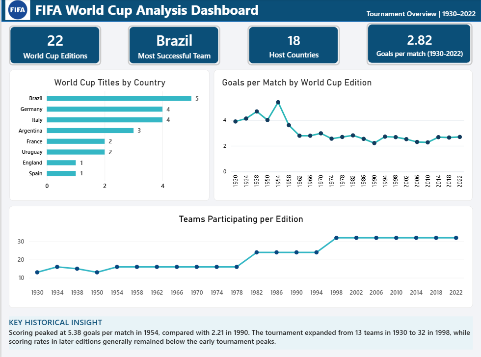
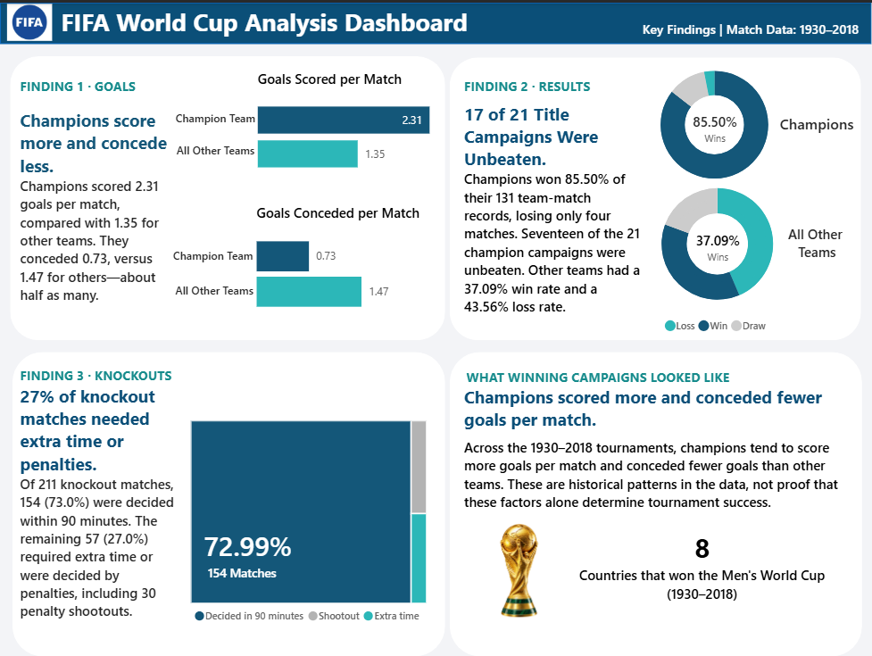

# FIFA World Cup Analysis Dashboard | Power BI

An interactive, three-page Power BI dashboard exploring FIFA Men's World Cup history, team performance and match outcomes from 1930 to 2022.

The project uses Power BI, DAX and Power Query to transform historical football data into visual summaries, compare team-level performance and identify patterns across tournament editions.

## Dashboard Preview

### Page 1 — Tournament Overview (1930–2022)

Highlights:
- World Cup editions, host countries and title-winning nations.
- Goals scored per match across tournament editions.
- Changes in the number of participating teams.
- Historical scoring and tournament expansion patterns.

### Page 2 — Match and Team Analysis (1930–2018)

Highlights:
- Team win percentages, with a minimum-match threshold.
- Cumulative goal difference by team.
- Goals scored versus goals conceded per match for selected teams.
- Match-outcome distribution by tournament stage.

### Page 3 — Key Findings (1930–2018)

Highlights:
- Goals scored and conceded per match by tournament champions versus other teams.
- Win, draw and loss distributions for champions and other team-match records.
- Knockout match outcomes, including extra-time and penalty-shootout results.
- Historical observations about unbeaten title-winning campaigns.

> **Coverage note:** Page 1 includes tournament-level data through 2022. The match-level analyses on Pages 2 and 3 cover 1930–2018. Figures from these different coverage periods should not be compared without accounting for the difference.

## Key Findings

- **Brazil led the title rankings:** Brazil won five Men's World Cup titles through 2022.
- **Scoring varied by edition:** The 1954 tournament recorded approximately 5.38 goals per match, compared with approximately 2.21 in 1990.
- **Tournament participation expanded:** The number of participating teams increased from 13 in 1930 to 32 in 1998.
- **Unbeaten title campaigns:** 17 of the 21 title-winning campaigns from 1930–2018 were unbeaten, according to the analysed match records.
- **Champions' scoring and defence:** Champions averaged approximately 2.31 goals scored and 0.73 goals conceded per team-match record, compared with approximately 1.35 scored and 1.47 conceded for other teams.

These are descriptive findings from historical data. They do not establish that any single factor causes a team to win the tournament.

## Tools and Techniques

- **Microsoft Power BI** — report design, interactive visualisations and dashboard layout.
- **DAX** — measures for goals per match, win percentage, goal difference, match outcomes and other performance indicators.
- **Power Query** — data transformation, stage classification and match-result corrections.
- **Data modelling** — preparation of team-level match records from match-level data.
- **Exploratory data analysis** — comparisons across tournament editions, teams and match stages.

## Data Preparation and Methodology

### Team-match records

The match data was transformed into team-level records so that each match contributes a record for each participating team. This supports calculations of goals scored, goals conceded, wins, draws, losses and goal difference.

### Match-result classification

Penalty-shootout outcomes are classified separately from ordinary draws:

- The penalty-shootout winner is recorded as the match winner.
- The losing team is recorded as the match loser.
- Matches that remain level without a recorded penalty winner are classified as draws.
- Historical replayed fixtures are treated as separate matches.

This convention is used for the report's match-result metrics and affects win and draw percentages.

### Tournament-stage classification

Match stages were classified for the stage-level analysis. Knockout outcomes were analysed separately from group-stage matches, with the knockout visual using the corrected stage classification.

The knockout outcome categories shown in the report are:
- Decided in 90 minutes
- Penalty shootout
- Extra time

### Metric definitions

| Metric | Definition |
|---|---|
| Goals per match | Total goals divided by total matches |
| Win percentage | Team wins divided by team matches played |
| Goal difference | Goals scored minus goals conceded |
| Draw rate | Draws divided by matches played |
| Goals scored per match | Total goals scored by the relevant group divided by its team-match records |
| Goals conceded per match | Total goals conceded by the relevant group divided by its team-match records |

## Limitations

- The tournament overview and match-level pages use different date ranges.
- Historical team names, national-team identities and tournament formats can vary across editions.
- Champions are compared with all other team-match records; this is a descriptive comparison, not a like-for-like causal analysis.
- Win and draw percentages depend on the stated penalty-shootout classification.
- Historical patterns do not predict the results of future tournaments.

## Repository Contents

- `FIFA_Dashboard.pbix` — Power BI report file.
- `FIFA_Dashboard.pdf` — static export of the three-page dashboard.
- `README.md` — project overview, findings and methodology.
- `screenshots/` — preview images of the three dashboard pages.

## Data Source and Attribution

**Original dataset:** Maven Analytics: https://mavenanalytics.io/data-playground/world-cup

The source and licence should be verified before redistributing the underlying dataset. This repository should not be treated as the original source of the historical data.

## How to View the Project

1. Open `FIFA_Dashboard.pdf` for a quick view of the report.
2. Download `FIFA_Dashboard.pbix` to inspect the interactive report in Microsoft Power BI Desktop.
3. Review the dashboard screenshots above for a quick overview of each page.

Created to demonstrate practical skills in Power BI reporting, DAX measures, Power Query transformations, data modelling and historical data analysis.
